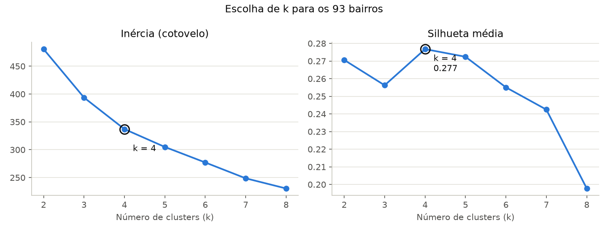
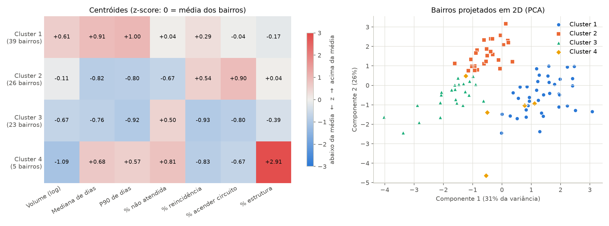

# Perfis de bairros com k-means

## Problema

O plano de ação 5W2H precisa decidir onde priorizar a manutenção da iluminação pública. Para isso, é útil saber quais bairros se parecem entre si: onde há muitas solicitações, onde o atendimento registrado demora mais, onde há mais pendências, onde o defeito costuma ser um trecho inteiro apagado ou um dano na estrutura.

Esta análise é **descritiva**. Ela usa todo o período do recorte (solicitações abertas de 01/01 a 31/08/2025, 34.492 registros em 93 bairros) para descrever o perfil de cada bairro. Ela não faz previsão. A previsão de reincidência por rua é feita por uma rede neural separada.

Para reproduzir, execute na raiz do repositório:

```bash
.venv/bin/python scripts/cluster_neighborhoods.py
```

O script lê os CSVs de `data/processed/` e grava os arquivos desta pasta:

- `kmeans_neighborhoods.csv`: indicadores e cluster de cada bairro;
- `kmeans_selection.png`: gráficos usados para escolher k;
- `kmeans_profiles.png`: perfil dos clusters.

## Por que k-means

- Não existe um rótulo "bairro prioritário" nos dados. É preciso um método **não supervisionado**, que encontre grupos sem resposta prévia.
- O k-means é simples de explicar e cada grupo é resumido por um **centróide**, o bairro médio do grupo. O centróide vira diretamente o perfil usado no plano de ação.
- Com 93 bairros e 7 indicadores numéricos, o cálculo é instantâneo e o resultado pode ser conferido à mão no CSV.

## Como o k-means funciona

Cada bairro é um ponto num espaço de 7 dimensões, uma por indicador. O algoritmo:

1. Escolhe k, o número de grupos. Aqui, k = 4.
2. Sorteia k pontos iniciais para servir de centróides. O sorteio usa semente fixa (`random_state=42`), então o resultado é sempre o mesmo.
3. Atribui cada bairro ao centróide mais próximo, pela distância euclidiana.
4. Recalcula cada centróide como a média dos bairros do seu grupo.
5. Repete os passos 3 e 4 até os grupos pararem de mudar.
6. Como o resultado depende do sorteio inicial, o processo é repetido 20 vezes (`n_init=20`) e fica a execução com a menor **inércia**, que é a soma das distâncias ao quadrado de cada bairro até o seu centróide. Quanto menor a inércia, mais compactos os grupos.

O algoritmo mede distâncias. Por isso os indicadores precisam estar na mesma escala, senão o volume (dezenas a milhares) dominaria os percentuais (0 a 1).

## Indicadores e normalização

Os indicadores são calculados por bairro, em todo o período:

| Indicador | Cálculo | O que indica |
|---|---|---|
| `volume` | Total de solicitações. No modelo entra como log(1 + volume) | Demanda registrada |
| `mediana_dias` | Mediana de `data_ultima_situacao − data_demanda`, só entre as `ATENDIDA` | Tempo típico até o atendimento registrado |
| `p90_dias` | Percentil 90 do mesmo intervalo | Cauda de casos demorados |
| `pct_nao_atendida` | Fração com situação diferente de `ATENDIDA` | Pendências na última situação publicada |
| `pct_reincidencia` | Fração das solicitações feitas em ruas com 2 ou mais solicitações no período. A rua é o par bairro + logradouro em maiúsculas, com espaços repetidos removidos | Concentração de pedidos na mesma rua |
| `pct_circuito` | Fração do serviço 51, ACENDER CIRCUITO | Trechos inteiros apagados |
| `pct_estrutura` | Fração dos serviços 61, 63, 65 e 289 (reposição de luminária, reposição de poste, implantação e reposição de vão de rede) | Danos na estrutura física |

O serviço 55, MANUTENCAO EM LAMPADA APAGADA, representa 76% de todas as solicitações e aparece em todos os bairros. Por isso ele não foi usado como indicador de gravidade.

O log no volume reduz o peso dos poucos bairros muito grandes. Boa Viagem tem 2.420 solicitações e Ponto de Parada tem 23. Depois disso, todos os indicadores passam por **z-score** (`StandardScaler`): de cada valor subtrai-se a média dos 93 bairros e divide-se pelo desvio padrão. Um z de +1 significa "um desvio padrão acima da média dos bairros".

Bairros com poucas solicitações foram mantidos: 20 bairros têm menos de 100 e 6 têm menos de 60. Nesses bairros, percentuais e percentis variam muito com poucos registros e devem ser lidos com cautela.

## Escolha de k

Foram testados k de 2 a 8 com duas medidas:

- **Inércia (cotovelo):** sempre cai quando k aumenta. Procura-se o ponto a partir do qual a queda fica pequena.
- **Silhueta média:** vai de −1 a 1 e compara a distância de cada bairro ao próprio grupo com a distância ao grupo vizinho. Quanto maior, mais separados os grupos.

| k | Inércia | Silhueta |
|---|---:|---:|
| 2 | 480,7 | 0,271 |
| 3 | 393,7 | 0,256 |
| **4** | **337,1** | **0,277** |
| 5 | 305,0 | 0,272 |
| 6 | 277,1 | 0,255 |
| 7 | 248,7 | 0,242 |
| 8 | 230,5 | 0,198 |



O valor escolhido foi **k = 4**:

- Tem a maior silhueta (0,277). Os valores de k = 5 (0,272) e k = 2 (0,271) são próximos, mas k = 2 é genérico demais para orientar ações.
- Na inércia, as quedas são de 87 (de 2 para 3) e 57 (de 3 para 4). A partir de k = 4 ficam em torno de 30 por grupo extra. Esse é o cotovelo.
- Quatro perfis cabem num plano de ação.
- Com k = 5, o grupo de demanda alta é dividido e surge um grupo de 6 bairros sem perfil claro.
- Rodando o k = 4 com as sementes 0 a 9, o ARI (Adjusted Rand Index, em que 1 indica grupos idênticos) mínimo em relação ao modelo final foi 0,920. Os grupos quase não mudam.

Uma silhueta perto de 0,28 indica estrutura **fraca a moderada**. Os bairros formam um contínuo, não ilhas bem separadas. Os grupos servem como resumo de perfis, não como fronteiras rígidas. Bairros perto da fronteira entre dois grupos podem ser revistos caso a caso no CSV.

## Perfis encontrados

Os clusters estão numerados pelo volume médio, do maior para o menor. Os valores da tabela são **médias dos bairros do grupo** nos indicadores originais. O volume total é a soma das solicitações dos bairros do grupo.

| Cluster | Perfil | Bairros | Volume médio (total) | Mediana de dias | P90 de dias | % não atendida | % reincidência | % acender circuito | % estrutura | RPAs (nº de bairros) | Exemplos |
|---|---|---:|---:|---:|---:|---:|---:|---:|---:|---|---|
| 1 | Alta demanda, atendimento mais lento | 39 | 596,6 (23.267) | 2,27 | 5,18 | 2,5% | 94,3% | 15,8% | 2,2% | 1 (6), 4 (11), 5 (14), 6 (8) | Boa Viagem, Santo Amaro, Boa Vista, Imbiribeira, Pina, Varzea |
| 2 | Demanda média, atendimento rápido, muitos circuitos apagados | 26 | 277,2 (7.206) | 1,00 | 2,21 | 1,1% | 95,7% | 25,3% | 2,7% | 1 (3), 2 (8), 3 (14), 4 (1) | Recife, Casa Amarela, Campo Grande, Macaxeira, Guabiraba, Encruzilhada |
| 3 | Baixa demanda, atendimento rápido, mais pendências | 23 | 154,1 (3.544) | 1,04 | 2,02 | 3,5% | 87,4% | 8,1% | 1,6% | 2 (10), 3 (13) | Nova Descoberta, Vasco da Gama, Agua Fria, Dois Unidos, Arruda, Linha do Tiro |
| 4 | Baixa demanda, danos na estrutura | 5 | 95,0 (475) | 2,10 | 4,46 | 4,2% | 88,0% | 9,4% | 10,4% | 1 (2), 3 (1), 5 (2) | Ilha Joana Bezerra, Poco, Coqueiral, Coelhos, Toto (todos) |

Para comparação, a média dos 93 bairros é: volume 370,9, mediana 1,60 dia, P90 3,53 dias, 2,5% não atendida, 92,6% de reincidência, 16,2% de acender circuito e 2,7% de estrutura.



No mapa de calor, cada célula é o centróide em z-score. Vermelho indica acima da média dos bairros e azul, abaixo. O gráfico da direita projeta os 93 bairros em duas dimensões por PCA (análise de componentes principais), que explica 57% da variância (31% + 26%). Serve só para visualização: o k-means usa as 7 dimensões.

Leitura de cada grupo:

- **Cluster 1, alta demanda e atendimento mais lento.** Reúne 67% das solicitações do recorte. Os tempos registrados são os mais altos: a mediana é de 2 a 3 dias em 38 dos 39 bairros, e o P90 vai de 4 a 9 dias. O grupo reúne 33 dos 36 bairros das RPAs 4, 5 e 6, além de bairros centrais da RPA 1. As exceções são Cidade Universitaria, no cluster 2, e Coqueiral e Toto, no cluster 4.
- **Cluster 2, demanda média, atendimento rápido e muitos circuitos apagados.** A mediana é de 1 dia ou menos em 25 dos 26 bairros, e há poucas pendências. O traço que distingue o grupo é a maior fração de ACENDER CIRCUITO (z +0,90), com Guabiraba (47%) e Dois Irmaos (46%) no topo. Fica quase todo nas RPAs 2 e 3.
- **Cluster 3, baixa demanda, atendimento rápido e mais pendências.** O atendimento registrado também é rápido, mas a fração não atendida está acima da média (z +0,50). A reincidência e a fração de circuitos estão abaixo da média. O grupo está todo nas RPAs 2 e 3 e inclui o bairro com menos registros (Ponto de Parada, 23).
- **Cluster 4, baixa demanda e danos na estrutura.** É um grupo pequeno, definido pela fração de reposição de luminária, poste e vão de rede (z +2,91, em média 10,4% contra 2,7% no geral). Também tem a maior fração não atendida e tempos mais longos. Como os bairros têm entre 35 e 194 solicitações, poucos registros mudam os percentuais.

Os tempos se dividem por região: 35 dos 36 bairros das RPAs 4, 5 e 6 têm mediana de 2 a 3 dias, e 45 dos 46 bairros das RPAs 2 e 3 têm 1 dia ou menos. Os dados não explicam a causa, que pode ser a forma de operar ou de registrar em cada região. Isso deve ser verificado antes de concluir que alguma região é mais lenta de fato.

## Entrada para o 5W2H

| Cluster | Que tipo de ação faz sentido |
|---|---|
| 1, alta demanda e atendimento mais lento | Reforçar a capacidade de atendimento e investigar o prazo nas RPAs 4, 5 e 6, começando pelos bairros de maior volume (Boa Viagem, Santo Amaro, Boa Vista) |
| 2, demanda média, atendimento rápido e muitos circuitos apagados | Inspecionar circuitos e comandos (relés, alimentação) nos bairros com mais ACENDER CIRCUITO, para reduzir apagões de trechos inteiros |
| 3, baixa demanda, atendimento rápido e mais pendências | Revisar e encerrar as solicitações em PENDENCIA ou PREPARACAO e checar se há obstáculo que impede a execução |
| 4, baixa demanda e danos na estrutura | Vistoriar postes, luminárias e vãos de rede e planejar obras de reposição, que exigem material e equipe diferentes da troca de lâmpada |

## Limitações

- **Só a última situação publicada.** Não há histórico de transições. A fração "não atendida" é a foto da extração, não o estoque em 31/08/2025.
- **Tempo só para `ATENDIDA`.** As demais situações não têm data de resolução. A data da última situação não é necessariamente a data do reparo, e os intervalos são em dias inteiros, o que deixa a mediana pouco variada (0 a 3 dias).
- **Volume não é taxa de falhas.** Não há tamanho da rede (número de pontos de luz), extensão das vias nem população por bairro. Volume alto pode refletir bairro maior ou mais pedidos, não necessariamente rede pior.
- **Logradouro é texto livre.** A normalização (maiúsculas e espaços) não une grafias diferentes da mesma rua nem separa trechos distantes de uma via longa. Em oito meses, a maioria das ruas tem dois ou mais pedidos (média de 92,6% por bairro), então a reincidência distingue os bairros mais pelo z-score do que pela diferença absoluta.
- **Bairros pequenos.** Com poucas solicitações, um único registro muda percentuais e percentis. O cluster 4 é o mais afetado.
- **Estrutura fraca.** Com silhueta de 0,277, os grupos resumem tendências e não são categorias rígidas. A escolha dos indicadores influencia os grupos: outro conjunto de indicadores daria outros grupos.
