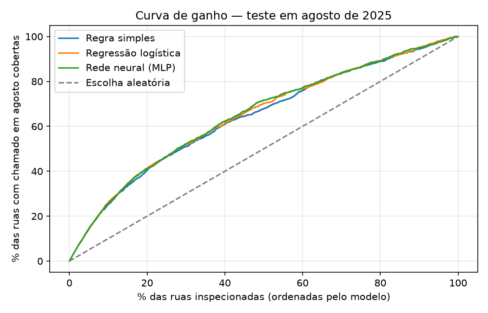

# Rede neural: ruas com nova solicitação no mês seguinte

## Problema

A equipe de manutenção pode inspecionar um número limitado de ruas por mês. A pergunta é: **quais ruas devem ser inspecionadas primeiro para cobrir o maior número de ruas que voltarão a registrar solicitação no mês seguinte?**

A análise assume que inspecionar essas ruas orienta a manutenção para os locais certos. Os dados não permitem medir se a inspeção evitaria a solicitação.

A unidade é a rua, definida por bairro e logradouro. A previsão por poste não é possível, pois a fonte não publica a identificação do ponto de luz. A previsão por bairro não acrescenta informação, porque 92 ou 93 dos 93 bairros têm solicitações em todos os meses.

## Dados e janela deslizante

Cada amostra é uma rua em um mês de corte. As variáveis usam apenas os **3 meses anteriores ao corte**. O alvo é 1 quando a rua tem ao menos uma solicitação no mês do corte.

| Mês de corte | Histórico | Alvo | Uso |
|---|---|---|---|
| abril, maio, junho | 3 meses anteriores | mês do corte | treino (10.133 amostras) |
| julho | abril a junho | julho | validação (3.404) |
| agosto | maio a julho | agosto | teste (3.540) |
| setembro | junho a agosto | sem dado | lista de inspeção |

Como todas as janelas têm o mesmo tamanho, as contagens são comparáveis entre os cortes. Cerca de um terço das amostras é positiva (33,9% no treino e 32,4% no teste).

A situação publicada é a de setembro de 2025. Para não usar informação posterior ao corte, uma solicitação só é considerada atendida se a data da última situação for anterior ao corte. O tempo até o atendimento usa apenas essas solicitações.

## Variáveis

| Variável | Significado | Normalização |
|---|---|---|
| Nº de solicitações | Intensidade no trimestre | log(1 + x) |
| Meses com solicitação | Persistência: 0 a 3 meses | ÷ 3 |
| Dias desde a última | Recência em relação ao corte | ÷ 90 |
| % abertas no corte | Solicitações ainda não atendidas | proporção |
| % ACENDER CIRCUITO | Trecho inteiro apagado | proporção |
| % estrutura | Reposição de luminária, poste ou vão de rede | proporção |
| Mediana de dias até atendimento | Lentidão no local | log(1 + x); sem atendimento usa a mediana do treino e um indicador |
| Nº de números distintos | Aproximação da extensão da rua; "0", "00", "SN" e "S/N" contam juntos como um único ponto sem número | log(1 + x) |
| RPA | Região | seis colunas 0/1 |

Depois dessas transformações, todas as variáveis passam por z-score (média 0 e desvio 1). Média e desvio são calculados somente no treino.

## Método

A rede neural é um **perceptron multicamadas (MLP)** com duas camadas ocultas de 32 e 16 neurônios e ativação ReLU. A saída é a probabilidade de a rua ter nova solicitação. O treino usa entropia cruzada binária, regularização L2 (alpha = 0,001) e parada antecipada. A arquitetura foi escolhida na validação entre (16), (32, 16) e (64, 32). As AUCs foram 0,712, 0,712 e 0,710, e a escolhida foi (32, 16). O modelo final foi treinado com os cortes de abril a julho.

A decisão de inspeção é um ranking. A rede ordena as ruas pela probabilidade, e a gestão define quantas ruas inspecionar (*k*). Com probabilidades estimadas, selecionar as *k* ruas de maior probabilidade maximiza o número esperado de ruas cobertas para aquele orçamento.

A rede é comparada com duas referências:

- **Regra simples:** ordenar as ruas pelo número de solicitações no trimestre.
- **Regressão logística:** equivale a uma rede com um único neurônio e sem camada oculta.

## Resultados no teste (agosto de 2025)

| Modelo | AUC | Precisão nas 100 primeiras | Precisão nas 200 | Precisão nas 500 | Cobertura nas 500 |
|---|---|---|---|---|---|
| Regra simples | 0,709 | 97,0% | 91,5% | 73,8% | 32,2% |
| Regressão logística | 0,718 | 96,0% | 91,0% | 75,4% | 32,9% |
| Rede neural (MLP) | 0,721 | 95,0% | 92,5% | 75,6% | 33,0% |

Com cinco sementes aleatórias, a AUC da rede foi 0,718 ± 0,002.

Curva de ganho da rede: inspecionando as ruas na ordem do modelo, a cobertura das ruas com solicitação em agosto foi:

| Ruas inspecionadas | 5% | 10% | 20% | 30% | 50% |
|---|---|---|---|---|---|
| Rede neural | 14% | 26% | 41% | 52% | 72% |
| Regra simples | 14% | 25% | 40% | 51% | 68% |



## Interpretação

- **O histórico recente explica quase todo o resultado.** A rede supera a escolha aleatória com folga e a regra simples por pouco (ver [Verificações](#verificações)). A vantagem aparece no meio da lista (30% a 50% das ruas), com 1 a 4 pontos de cobertura. A regressão logística fica praticamente empatada com a rede.
- **O topo da lista é confiável.** Das 200 ruas com maior probabilidade, 92,5% tiveram nova solicitação em agosto, contra 32% na média.
- **O topo é dominado por avenidas.** Avenidas longas e movimentadas acumulam solicitações todo mês. Algumas, como a Av. Norte Miguel Arraes de Alencar, aparecem em vários bairros porque a chave é bairro e logradouro.
- **Ruas sem histórico ficam de fora.** Em agosto, 1.677 ruas tiveram solicitação, e 530 delas (32%) não tinham registro nos 3 meses anteriores. O modelo não consegue indicar essas ruas.

A lista de setembro de 2025, com as 200 ruas de maior probabilidade, está em [inspection_list_2025_09.csv](inspection_list_2025_09.csv).

## Verificações

As verificações estão em `scripts/verify_street_models.py`. Os resultados completos ficam em [verification_results.json](verification_results.json).

**Overfitting.** Modelos treinados com os cortes de abril a junho:

| Modelo | AUC treino | AUC validação (jul) | AUC teste (ago) |
|---|---|---|---|
| Rede (16) | 0,736 | 0,712 | 0,719 |
| Rede (32, 16), escolhida | 0,743 | 0,712 | 0,721 |
| Rede (64, 32) | 0,745 | 0,710 | 0,722 |
| Regressão logística | 0,730 | 0,707 | 0,717 |
| Regra simples, sem treino | 0,718 | 0,701 | 0,709 |

O teste ficou igual ou acima da validação em todos os modelos, então a escolha da arquitetura não se ajustou demais a julho. A queda do treino para a validação também aparece na regra simples, que não aprende nada. Por isso, a maior parte dela vem da diferença entre os meses.

Para comparação, redes sem regularização e sem parada antecipada, treinadas com abril a julho:

| Rede | AUC treino | AUC teste | Épocas |
|---|---|---|---|
| (32, 16) com L2 e parada antecipada | 0,734 | 0,721 | 20 |
| (32, 16) sem proteção | 0,769 | 0,697 | 273 |
| (256, 128) sem proteção | 0,882 | 0,644 | 291 |

A rede grande sem proteção decora o treino e piora no teste. A configuração usada interrompe o treino em 20 épocas.

**Vazamento.** Com o alvo do treino embaralhado, a AUC no teste foi 0,511, próxima do acaso. As variáveis não carregam informação do mês previsto.

**Diferença entre modelos.** Bootstrap pareado com 500 reamostragens do teste:

- rede menos regressão logística: +0,003 de AUC (IC 95%: −0,003 a +0,009), sem diferença significativa;
- rede menos regra simples: +0,012 de AUC (IC 95%: +0,003 a +0,022).

**Subgrupos.** Dentro de cada faixa de histórico, a AUC fica entre 0,53 e 0,69 em todos os modelos. Depois de conhecido o número de solicitações da rua, as demais variáveis acrescentam pouca informação. A rede fica à frente nas ruas com 5 a 9 solicitações (0,685 contra 0,674 da logística). Nas ruas com 10 ou mais, a regra simples é melhor (0,728 contra 0,675). Por RPA, as diferenças entre os modelos não passam de 0,02.

**Série semanal como entrada.** Com as 13 contagens semanais do trimestre no lugar das variáveis, a rede teve AUC de 0,712. Com as duas entradas juntas, 0,718, e a logística chegou a 0,725. A rede não encontrou padrão temporal além do que as variáveis resumem.

**Janelas e horizontes.**

| Histórico → horizonte | Ruas no teste | Regra | Logística | Rede |
|---|---|---|---|---|
| 1 mês → 1 mês | 1.839 | 0,681 | 0,700 | 0,696 |
| 1 mês → 2 meses | 1.778 | 0,652 | 0,668 | 0,662 |
| 3 meses → 1 mês (usado) | 3.540 | 0,709 | 0,718 | 0,721 |
| 3 meses → 2 meses | 3.404 | 0,701 | 0,708 | 0,707 |

Com 1 mês de histórico, os modelos treinados se afastam mais da regra simples, mas a AUC geral cai e metade das ruas fica sem histórico para ser avaliada. A janela de 3 meses com horizonte de 1 mês teve o melhor resultado.

**Conclusão.** A rede é estável, não apresenta overfitting e supera a regra simples com significância estatística, mas não supera a regressão logística. O sinal disponível é quase todo explicado pelo histórico recente da rua. Para uso operacional, a regressão logística entrega o mesmo resultado e é mais simples de manter e explicar. A rede foi mantida como método da análise e serve de base para a [sobrevivência neural](survival.md).

## Limites

- Logradouro é texto livre e pode ter variações de grafia.
- Uma avenida conta como uma única rua por bairro, independentemente da extensão.
- Solicitação não é falha: o mesmo defeito pode gerar vários registros, e ruas movimentadas têm mais chance de serem reportadas.
- O período tem 8 meses, o que não permite avaliar sazonalidade.
- O teste usa um único mês (agosto de 2025).

## Reproduzir

```bash
python3 -m venv .venv
.venv/bin/pip install -r requirements.txt
.venv/bin/python scripts/predict_street_recurrence.py
.venv/bin/python scripts/verify_street_models.py  # cerca de 12 minutos, por causa da rede grande sem proteção
```

O script lê `data/processed/` e grava em `docs/analysis/` a curva de ganho, os resultados em JSON e a lista de setembro.
