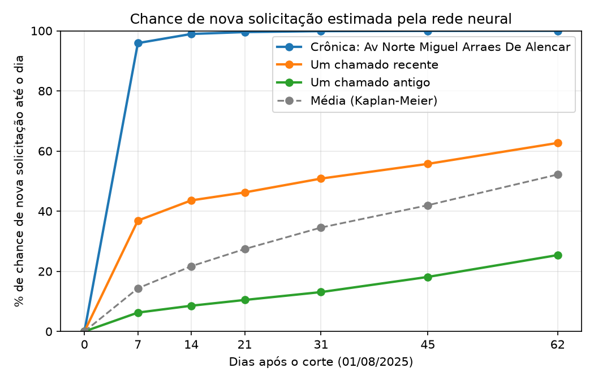

# Sobrevivência neural: quando a rua terá a próxima solicitação

## Problema

A [rede de classificação](neural_network.md) responde se a rua terá solicitação no mês seguinte. Para agendar inspeções, também importa **quando**: uma rua com risco alto na primeira semana deve ser visitada antes de uma rua cujo risco se distribui pelo mês.

A análise de sobrevivência estima, para cada rua, a chance de nova solicitação até 7, 14, 21, 31, 45 e 62 dias após o corte. O evento é a primeira solicitação depois do corte.

## Censura

Os dados terminam em 31/08/2025. Uma rua sem solicitação entre 01/08 e 31/08 não tem o evento observado: sabe-se apenas que ele não ocorreu nos primeiros 31 dias. Esse caso é uma **censura**. O modelo usa essa informação parcial: a rua conta como "sem solicitação até o dia 31" e não contribui para os intervalos seguintes.

A censura também separa treino e teste. No treino final, os cortes de abril a julho são censurados em 01/08 e, portanto, não usam solicitações de agosto.

## Método

O modelo é de **risco discreto** (*logistic hazard*). O tempo é dividido em seis intervalos: 0–7, 7–14, 14–21, 21–31, 31–45 e 45–62 dias. A rede recebe as mesmas variáveis da classificação e tem uma saída por intervalo:

```
variáveis da rua (15) → camada de 32 → camada de 16 → 6 saídas sigmoide (h₁ … h₆)
```

Cada saída hₖ é o risco no intervalo k, dado que a rua não teve solicitação antes dele. A chance acumulada até o fim do intervalo k é 1 − (1 − h₁)(1 − h₂)…(1 − hₖ).

A função de perda é a log-verossimilhança negativa:

- rua com evento no intervalo k: log(1 − h₁) + … + log(1 − hₖ₋₁) + log(hₖ);
- rua censurada: soma de log(1 − hⱼ) nos intervalos completos antes da censura.

O treino usa PyTorch, Adam (taxa 0,001), decaimento de pesos 0,0001 e lotes de 256. O número de épocas é escolhido por parada antecipada na validação de julho. O resultado é a média de três sementes.

## Comparação no teste (agosto de 2025)

| Modelo | AUC 7 dias | AUC 14 dias | AUC 31 dias | C-index | Precisão nas 200 primeiras | Brier 31 dias |
|---|---|---|---|---|---|---|
| Regra simples | 0,730 | 0,732 | 0,709 | 0,687 | 91,5% | — |
| Regressão logística | 0,745 | 0,742 | 0,718 | 0,696 | 91,0% | 0,182 |
| Rede de classificação | 0,753 | 0,749 | 0,723 | 0,700 | 91,5% | 0,180 |
| Sobrevivência linear | 0,745 | 0,741 | 0,718 | 0,696 | 90,5% | 0,181 |
| Sobrevivência neural | 0,750 | 0,744 | 0,721 | 0,699 | 91,8% | 0,181 |
| Kaplan-Meier (sem variáveis) | — | — | — | — | — | 0,219 |

O **C-index** mede se as ruas com solicitação mais cedo receberam risco maior (0,5 é acaso). O **Brier** mede o erro quadrático entre a probabilidade prevista e o ocorrido (menor é melhor). O Kaplan-Meier usa a mesma curva média para todas as ruas.

No ordenamento das ruas, os modelos ficam praticamente empatados, como na classificação. A diferença está na saída: um único modelo fornece a chance em vários prazos, com calibração melhor que a média da cidade (Brier 0,181 contra 0,219). A versão linear produz curvas equivalentes, ou seja, o resultado não depende da camada oculta.



## Tipos de rua

As curvas previstas para o corte de agosto foram agrupadas com k-means (z-score em cada ponto da curva, k = 3). A silhueta foi 0,686 com k = 2 e 0,621 com k = 3. Foi escolhido k = 3 para separar três prazos de ação. Os grupos são nomeados pelo risco médio em 31 dias.

Validação com o que ocorreu em agosto:

| Tipo | Ruas | Previsto em 7 dias | Ocorrido em 7 dias | Previsto em 31 dias | Ocorrido em 31 dias | Parte das solicitações em 7 dias | Parte em 31 dias | Perfil típico |
|---|---|---|---|---|---|---|---|---|
| Crônica | 325 (9%) | 56,5% | 53,8% | 86,4% | 85,2% | 36% | 24% | 12 solicitações no trimestre, a última há 3 dias |
| Recorrente | 937 (26%) | 19,6% | 16,0% | 48,6% | 40,9% | 31% | 33% | 4 solicitações, a última há 16 dias |
| Esporádica | 2.278 (64%) | 7,7% | 7,0% | 23,1% | 21,4% | 33% | 43% | 1 solicitação, há 46 dias |

- As ruas crônicas são 9% das ruas e concentraram 36% das solicitações da primeira semana.
- Crônicas e recorrentes somam 35% das ruas e 57% das solicitações do mês.
- O risco previsto ficou próximo do ocorrido. Nas recorrentes, o modelo superestimou o risco em cerca de 8 pontos.
- Os grupos se distinguem principalmente pelo nível de risco, não pelo formato da curva. O prazo de ação vem da concentração do risco: nas crônicas, a maior parte ocorre na primeira semana.

## Plano de setembro

O modelo foi aplicado ao corte de 01/09/2025, com histórico de junho a agosto. O arquivo [inspection_plan_2025_09.csv](inspection_plan_2025_09.csv) lista as 1.185 ruas crônicas e recorrentes, com prioridade, risco em 7 e 31 dias e o perfil do bairro obtido no [k-means de bairros](kmeans.md).

| Tipo de rua | Prioridade | Perfil 1: alta demanda | Perfil 2: circuitos apagados | Perfil 3: mais pendências | Perfil 4: estrutura | Total |
|---|---|---|---|---|---|---|
| Crônica | semana 1 | 206 | 84 | 30 | 8 | 328 |
| Recorrente | no mês | 633 | 114 | 95 | 15 | 857 |
| Esporádica | sem ação preventiva | 1.427 | 390 | 435 | 55 | 2.307 |

O tipo de rua define o prazo e o perfil do bairro indica a equipe: circuitos no perfil 2 e estrutura no perfil 4.

## Limites

- Os pontos de 45 e 62 dias não são avaliados no teste, que tem apenas 31 dias observados.
- O teste usa um único corte (agosto de 2025).
- A análise assume que a inspeção orienta a manutenção para as ruas certas. Os dados não medem se ela evita a solicitação.
- Valem os limites da [classificação](neural_network.md#limites): logradouro em texto livre, avenidas tratadas como uma rua por bairro e solicitação diferente de falha.

## Reproduzir

```bash
.venv/bin/python scripts/cluster_neighborhoods.py
.venv/bin/python scripts/survival_street_recurrence.py
```

O k-means de bairros deve ser executado antes, pois o plano usa os perfis de bairro.
